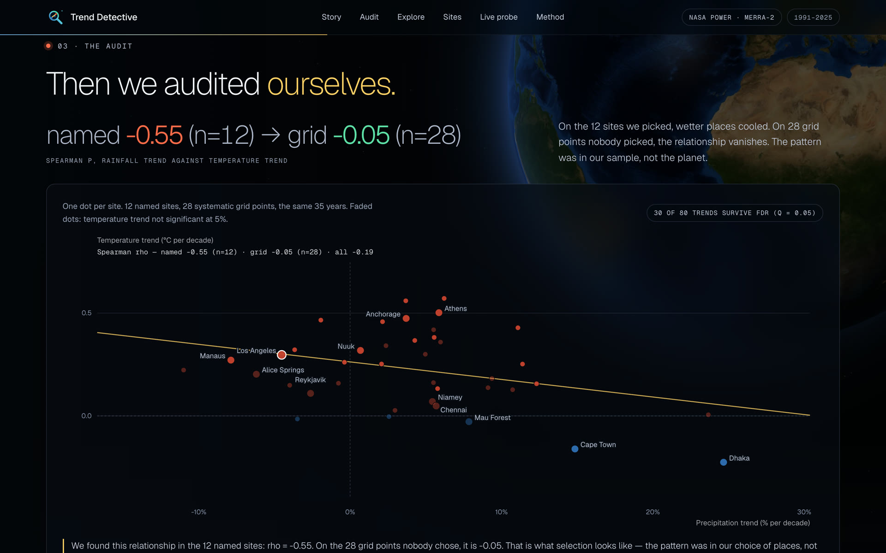

<p align="center">
  <a href="https://www.spaceappschallenge.org/">
    
  </a>
</p>

<h1 align="center">
  
  Trend Detective
</h1>

<p align="center">
  <strong>Climate trends, with the evidence in view.</strong><br>
  Explore 35 years of NASA temperature and rainfall data, with significance tests and a sampling audit.<br>
  2026 NASA Space Apps Challenge: <em>Be An Earth System Trend Detective!</em>
</p>

<p align="center">
  <a href="https://ihatesas.github.io/trend-detective/"></a>
  &nbsp;
  <a href="https://ihatesas.github.io/trend-detective/demo.mp4"></a>
  &nbsp;
  <a href="documentation/METHODOLOGY.md"></a>
</p>

<p align="center"><sub>Team aini &nbsp; · &nbsp; Universal Event &nbsp; · &nbsp; NASA POWER / MERRA-2 &nbsp; · &nbsp; 1991–2025</sub></p>

<table>
  <tr>
    <td width="33%" valign="top">
      <br>
      <strong>Explore the trends</strong><br>
      Compare temperature and rainfall across 40 locations.
    </td>
    <td width="33%" valign="top">
      <br>
      <strong>Check the evidence</strong><br>
      Inspect slopes, significance, and false-discovery correction.
    </td>
    <td width="33%" valign="top">
      <br>
      <strong>Audit the sample</strong><br>
      See how the result changes with the locations selected.
    </td>
  </tr>
</table>

<details>
  <summary>Preview the interactive sampling audit</summary>
  <br>
  <a href="https://ihatesas.github.io/trend-detective/">
    
  </a>
</details>

## The project

Trend Detective examines 35 years of NASA POWER / MERRA-2 data at 40 locations.
The interactive map and site charts show what changed, where, by how much, and
whether the change is statistically significant.

The sampling audit compares 12 named locations with 28 land points on a fixed
20° grid. An apparent relationship between rainfall and temperature trends in the
named locations weakens in the grid sample. The app makes both results visible
so readers can inspect the effect of site selection.

| Coverage | Variables | Tests | After correction |
| --- | --- | --- | --- |
| 40 sites · 1991–2025 | Temperature and rainfall | 80 trends · 34 with p < 0.05 | 30 survive FDR at q = 0.05 |

## What you can explore

- **Trend map:** compare the direction, size, and significance of changes across locations.
- **Site histories:** inspect annual values alongside Sen's slope; hover or use the arrow keys to read individual years.
- **Sampling audit:** compare rainfall–temperature trend correlations for named sites (ρ = −0.55), grid points (ρ = −0.05), and all sites (ρ = −0.19).
- **Methods and limits:** see how Mann–Kendall tests and Benjamini–Hochberg correction affect the findings.

The [screen capture](https://ihatesas.github.io/trend-detective/demo-capture.mp4)
shows the tool in use. The narrated demo and its build instructions are in
[`video/`](video/).

## Run locally

The app is static HTML, CSS, and JavaScript. The analysis uses Python's standard
library. No API key or package installation is required to explore the included data.

```bash
git clone https://github.com/ihateSAS/trend-detective.git
cd trend-detective
python3 -m http.server 4517 --directory web
```

Open [localhost:4517](http://localhost:4517). The included dataset is ready to use.
You can also open [`dist/trenddetective.html`](dist/trenddetective.html), the
self-contained app bundle, directly in a browser.

To recompute the analysis and rebuild the app:

```bash
python3 ingest.py
python3 build.py
```

The ingestion script uses cached NASA POWER responses in `data/raw/` when available.
It writes annual series and statistics to `data/series.json` and `web/data.js`.
The build script bundles the web source into `dist/trenddetective.html` and
`docs/index.html`, which GitHub Pages serves.

`NO_GRID=1 python3 ingest.py` reproduces the original 12-site analysis used in the
sampling audit. Rerun `python3 ingest.py` without that flag to restore all 40 sites
before rebuilding.

## Repository guide

| Path | Contents |
| --- | --- |
| [`web/`](web/) | App source, interactive charts, map, and bundled data |
| [`ingest.py`](ingest.py) | Data ingestion, annual aggregation, and trend statistics |
| [`data/`](data/) | Cached NASA responses and computed annual series |
| [`build.py`](build.py) | Self-contained HTML bundler |
| [`docs/`](docs/) | Published app and demonstration videos |
| [`video/`](video/) | Narrated film source and rendering instructions |
| [`documentation/`](documentation/) | Detailed methodology, findings, and archived submission notes |

## Interpretation

MERRA-2 is a reanalysis model constrained by observations. The 20° grid is coarse,
35 years can include multi-decade variability, and a correlation between trends
does not establish causation. Temperature and precipitation in the reanalysis
are also not independent. These results describe the sampled locations.

The app keeps null results visible: Los Angeles rainfall has p = 0.53 and is
reported as no significant trend. Temperature slopes use °C per decade;
percentage changes are reserved for rainfall because Celsius has an arbitrary zero.

See the [full methodology and site results](documentation/METHODOLOGY.md) for
aggregation rules, significance tests, limitations, and planned improvements.

## Data and credits

- [NASA POWER monthly point API](https://power.larc.nasa.gov/docs/services/api/temporal/monthly/): MERRA-2, community AG; `T2M` and `PRECTOTCORR`, 1991–2025.
- [Natural Earth 1:110m country boundaries](https://www.naturalearthdata.com/downloads/110m-cultural-vectors/110m-admin-0-countries/): public domain map outlines and land mask.
- Statistical methods: Mann (1945), Kendall (1975), Sen (1968), and Benjamini & Hochberg (1995).

## Team

- Daniel Huang
- Gabriel Wu
- John Xie

## AI disclosure

DeepSeek V4.1 Flash Fast assisted with the analysis pipeline, `ingest.py`, the web
demo, and initial writeup under the team's direction and review. Reported numbers
come from running the committed code against NASA POWER data; statistical methods
were selected and reviewed by the team.

The narrated film uses AI-generated voice and is visibly labeled. See
[`video/README.md`](video/README.md) for production details.
